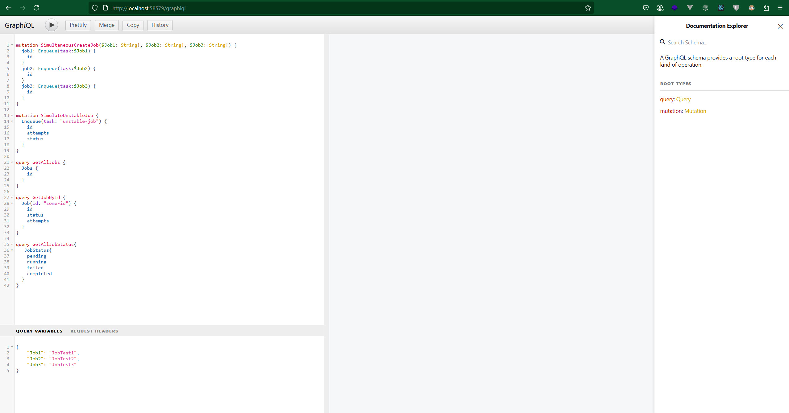

# job-queue-go

[](https://github.com/afiqanasywa/job-queue-go/actions/workflows/ci.yml)

A personal case study: a concurrent in-memory job queue in Go, with a GraphQL API.

Jobs are submitted through a GraphQL mutation, processed in the background by a pool of workers, and retried when they fail. All state is kept in memory, so there is no database to set up.



## Features

- **Worker pool**: 10 goroutines read job IDs from a buffered channel (capacity 100).
- **Retries that don't block workers**: a failed attempt is retried up to 3 attempts in total with linear backoff (1s, then 2s). The wait happens on a timer, so the worker moves on to other jobs in the meantime.
- **Idempotency**: pass an `idempotencyKey` and sending the same request again returns the same job instead of running it twice. A job is also claimed atomically before each attempt, so two workers can never run the same job.
- **Concurrency-safe storage**: the in-memory repository uses a `sync.RWMutex` and only hands out copies of jobs, so callers never share memory with the store.
- **Backpressure**: when the queue is full, `Enqueue` waits briefly and then returns a clear "queue is full" error. Jobs are never left stuck in `pending`.
- **Graceful failure and shutdown**: a panicking task is recorded as a failed attempt instead of crashing the worker. On SIGINT/SIGTERM the server stops accepting requests and lets running jobs finish.
- **GraphQL API** (graph-gophers/graphql-go on Echo), with a per-request DataLoader for batched lookups by ID.
- **Structured logging** with zap: enqueue, duplicate, attempt, retry, completion and failure events.

## Architecture

```
delivery/graphql   GraphQL schema (go:embed), resolvers, per-request dataloader
service            Worker pool, retries, idempotency, graceful shutdown
repository/inmem   Thread-safe in-memory storage with atomic state changes
entity             Domain models and errors
interface          Contracts between layers
pkg                Server bootstrap, handlers, constants
```

[docs/TECHNICAL.md](docs/TECHNICAL.md) covers the job lifecycle, concurrency model and design decisions.

## Running it

You need Go 1.23 or newer.

```bash
go run .
```

Then open http://localhost:58579/graphiql. In VS Code you can also use the `Go-Debug` launch configuration.

## API

| Operation | Type | Description |
|---|---|---|
| `Enqueue(task: String!, idempotencyKey: String)` | Mutation | Creates a job, or returns the existing one if the key was already used |
| `Jobs` | Query | Lists all jobs, oldest first |
| `Job(id: String!)` | Query | Gets one job by ID |
| `JobsByIds(ids: [String!]!)` | Query | Gets several jobs at once, batched by the DataLoader; unknown IDs are skipped |
| `JobStatus` | Query | Counts jobs by status: pending, running, failed, completed |

These task names simulate failures:

| Task | Behaviour |
|---|---|
| `unstable-job` | Fails twice, succeeds on the 3rd attempt |
| `failing-job` | Always fails and ends as `failed` after 3 attempts |
| anything else | Succeeds after about 100ms |

### Example

```graphql
mutation {
  a: Enqueue(task: "pay", idempotencyKey: "order-1") { id }
  b: Enqueue(task: "pay", idempotencyKey: "order-1") { id }   # same id as a
  c: Enqueue(task: "unstable-job") { id }
  d: Enqueue(task: "failing-job")  { id }
}
```

Run this query a few seconds later:

```graphql
{
  Jobs { task status attempts idempotencyKey }
  JobStatus { pending running failed completed }
}
```

```json
{
  "Jobs": [
    { "task": "pay",          "status": "completed", "attempts": 1, "idempotencyKey": "order-1" },
    { "task": "unstable-job", "status": "completed", "attempts": 3, "idempotencyKey": null },
    { "task": "failing-job",  "status": "failed",    "attempts": 3, "idempotencyKey": null }
  ],
  "JobStatus": { "pending": 0, "running": 0, "failed": 1, "completed": 2 }
}
```

[docs/playground.md](docs/playground.md) has more queries you can try.

## Tests

```bash
go test ./... -race -count=1
```

The tests cover the repository (copy semantics, atomic idempotency under 100 concurrent goroutines), the service (retries, max attempts, panics, a full queue, 100 concurrent jobs, retries not blocking workers, shutdown) and the GraphQL API end to end. CI runs them with the race detector on every push.

## What I improved after the first version

The first version worked for the happy path but had gaps that I found while reviewing it afterwards. Here is what I changed:

| Problem in v1 | Fix |
|---|---|
| The repository returned shared `*Job` pointers, so workers wrote fields that resolvers were reading at the same time (a data race) | The repository copies jobs in and out, and state changes go through the lock |
| No idempotency: every `Enqueue` created a new job | Optional `idempotencyKey`, checked and inserted atomically; `StartAttempt` claims a job so it can only run once at a time |
| When the queue was full, the job was saved but never queued, so it stayed `pending` forever | `Enqueue` waits up to 2s, then rolls the job back and returns `ErrQueueFull` |
| Retry backoff used `time.Sleep` inside the worker, so a retrying job kept the worker busy | Retries are re-queued from a timer; the worker is free immediately |
| No graceful shutdown | SIGINT/SIGTERM stops HTTP, then the workers, with a deadline |
| The DataLoader was shared across requests, so its cache could return old statuses | A new loader is created per request |
| The schema needed `go-bindata` code generation | The schema is embedded with `go:embed` |
| No tests | Unit, concurrency and GraphQL integration tests, run with `-race` in CI |

## Remaining limitations

- Storage is in memory, so pending jobs are lost on restart. A persistent repository (for example Postgres or Redis) would fix this behind the existing interface.
- Jobs are not prioritised and cannot be cancelled.
- There is no authentication or rate limiting on the API.
